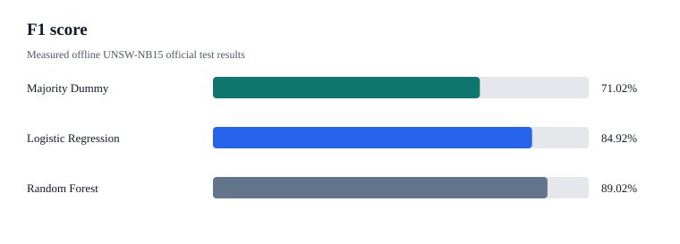

# AI-NIDS Research
### Auditing false alarms, feature interactions and evaluation artifacts in network intrusion detection

[](https://github.com/facei7505-droid/AI-NIDS-Research/actions/workflows/tests.yml)


> **Research snapshot · 19 November 2026.** Open research code with executed benchmarks and reproducible exploratory experiments. **Not peer reviewed; no claim of novel detector architecture, real-world deployment, independent external confirmation, or first-in-world discovery.** Software and manuscript are substantially AI-assisted.

**Research question.** *How much can the choice of synthetic feature-perturbation donors change the apparent false-alarm interactions of machine-learning NIDS?* We focus on measurement reliability rather than claiming a superior attack classifier.

[Project audit & scores](docs/PROJECT_AUDIT_2026-11-19.md) · [Read working paper](paper/MANUSCRIPT_DRAFT.md) · [Reproduce](docs/REPRODUCIBILITY.md) · [Experimental design](docs/RESEARCH_DESIGN.md) · [Evidence status](docs/STATUS.md) · [Related work](docs/RELATED_WORK.md)

---

## Key findings

### 1. Strong F1 can coexist with excessive false alarms

Models trained on 175,341 official-designated UNSW-NB15 training records and evaluated on 82,332 designated test records:

| Model | F1 | Attack recall | False positive rate | False alarms |
|---|---:|---:|---:|---:|
| Majority dummy | 0.7102 | 100.00% | 100.00% | 37,000 |
| Logistic Regression | 0.8492 | 97.26% | 38.95% | 14,412 |
| **Random Forest** | **0.8902** | **98.85%** | **28.47%** | **10,535** |



**Evidence:** [Original executed CSV](results/metrics_FULL_BENCHMARK.csv) · [Benchmark metadata and hashes](results/metadata_FULL_BENCHMARK.json) · [Fingerprint overlap audit](results/data_audit.json).

**Caution:** an audit found 8,541 test predictor rows (10.37%) sharing a training predictor fingerprint. A match is not proof of the same real network event.

### 2. A validation-selected 5% false-alarm budget did not transfer

| Validation-trained model | Official-test FPR after constrained threshold | Attack recall |
|---|---:|---:|
| Logistic Regression | 11.41% | 86.71% |
| Random Forest | 14.54% | 95.32% |

The RF threshold prevented **5,210** false alarms but missed **1,598** more attacks relative to the default threshold in the *same* validation-trained experiment. This is **post-hoc exploratory analysis** because the official test had already been inspected during the baseline phase.

**Evidence:** [Alert budget experiment](results/alert_budget_study.json) · [Quantified tradeoffs](results/ALERT_BUDGET_ANALYSIS.md).

### 3. The perturbation donor policy changes apparent feature interactions

For predefined **Protocol + Context** feature groups, the synthetic *excess FPR interaction* is:

```text
100 × [FPR(Protocol+Context) − FPR(Protocol) − FPR(Context) + FPR(clean)]
```

**Five-permutation-seed replication:** three grouped validation splits × five permutation seeds × two ML models × two donor policies = 60 evaluated conditions on the **training dataset only**.

| Model | Unrestricted donors | Same-class donor oracle | Difference |
|---|---:|---:|---:|
| Random Forest | +1.591 pp | −0.205 pp | **+1.796 pp** |
| Logistic Regression | +0.290 pp | +0.285 pp | +0.005 pp |

True class labels are used **only** in the retrospective oracle diagnostic; they cannot be used when detecting unknown attacks. The fifteen matched RF comparisons are *not fifteen independent datasets*.

**Class-blind observable matching:** grouping donors using observed duration and source bytes (three grouped splits × three donor seeds × two models × three policies = 54 conditions) changes the mean RF excess interaction:

| Donor policy | RF excess FPR interaction |
|---|---:|
| Unrestricted | +1.610 pp |
| Observable-stratified (no target labels) | **+0.959 pp** |
| Same-class oracle (retrospective control only) | −0.219 pp |

The measured group exchange fractions are all close to 25%. A separate 54-condition study that learns matching-bin boundaries strictly on the *training* records finds **+0.958734 pp** for the observable policy, close to the earlier validation-fitted +0.958702 pp.

**Evidence:** [60-condition replication](results/PERMUTATION_SEED_REPLICATION_REPORT.md) · [54-condition study](results/OBSERVABLE_DONOR_REPORT.md) · [Frozen-bin comparison](results/DONOR_QUANTILE_COMPARISON.md).

**Interpretation:** these are *synthetic diagnostic sensitivities*, not causal explanations of real attacks, certified robustness, or a newly invented conditional-permutation method.

## Reproduce

**Python 3.11.** Install dependencies, run tests, fetch checksum-validated historical inputs, then reproduce a training-only diagnostic:

```bash
git clone https://github.com/facei7505-droid/AI-NIDS-Research.git
cd AI-NIDS-Research
python -m venv .venv
# Activate your virtual environment (Windows: .\.venv\Scripts\Activate.ps1)
python -m pip install -r requirements.txt
python -m pytest -q
python src/download_data.py
python src/failure_fingerprints.py --train data/UNSW_NB15_training-set.csv
python src/report_failure_fingerprints.py
```

Other workflows are described in [REPRODUCIBILITY.md](docs/REPRODUCIBILITY.md). The downloader checks pinned SHA-256 values; datasets are **not** committed. Mirror file integrity is not equivalent to authenticating the data's original publisher.

## Repository map

```text
AI-NIDS-Research/
├── README.md                 Project overview and measured findings
├── paper/
│   └── MANUSCRIPT_DRAFT.md   Coherent working research paper
├── docs/
│   ├── RESEARCH_DESIGN.md    Research questions and controls
│   ├── REPRODUCIBILITY.md    Environment, data and commands
│   ├── RELATED_WORK.md       Prior studies and novelty boundaries
│   ├── STATUS.md             Verified vs missing evidence
│   ├── QUALITY_GATES.md      Research quality requirements
│   └── NETFLOW_V2_EXTERNAL_PLAN.md
├── src/                      Models, diagnostics, reporting, dataset audits
├── tests/                    Unit tests and published-evidence integrity checks
├── results/                  Executed CSV, JSON, Markdown and SVG evidence
└── .github/workflows/        CI and reproducible experiment runs
```

## Research roadmap and scientific limitations

| Requirement | Current status |
|---|---|
| Reproducible UNSW baseline and false-alarm audit | **Executed** |
| Training-only perturbation studies and falsification controls | **Executed, exploratory** |
| Training-fitted class-blind matching control | **Executed, exploratory** |
| Matched published-method comparisons | **Partial** |
| Dependence-aware uncertainty and multiple-testing control | **Incomplete** |
| Independent external-origin NetFlow-v2 evaluation | **Not executed** |
| Independent student verification / peer review | **Not verified** |

Our proposed external confirmation uses UQ's standardized **NF-UNSW-NB15-v2** and **NF-CSE-CIC-IDS2018-v2** collections, subject to exact schema, unit, feature-mapping and label-boundary checks. The [schema-audit script](src/audit_netflow_v2_schema.py) and [external validation protocol](docs/NETFLOW_V2_EXTERNAL_PLAN.md) exist, but **the actual external CSVs have not been acquired or evaluated**.

**Research limitations:** historical single-source traffic; overlapping validation splits; synthetic and sometimes physically inconsistent perturbations; post-hoc feature-pair selection; oracle label leakage risk if misused; incomplete external validation. Dataset-origin reproducibility does not imply deployed IDS reliability.

## Citation, acknowledgments and use

See [CITATION.cff](CITATION.cff) for how to cite the **unpublished research software**. Original data: [UNSW-NB15](https://research.unsw.edu.au/projects/unsw-nb15-dataset); standardized external-study candidate: [UQ ML-NIDS data](https://www.cyber.uq.edu.au/project/machine-learning-based-nids-datasets). Relevant methodology includes [ADBench](https://github.com/Minqi824/ADBench) and the [NeurIPS reproducibility checklist](https://neurips.cc/public/guides/PaperChecklist).

**Authorship transparency:** substantial coding, documentation and experimental planning were AI-assisted. A human researcher must independently verify scientific claims and disclose assistance in any submission.

**Licensing:** an explicit software license has not been selected; public visibility does **not** automatically grant a right to reuse or redistribute this code. Dataset rights remain with the respective providers.

_Last verified documentation update: 19 November 2026._
